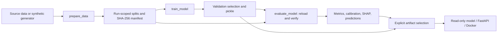
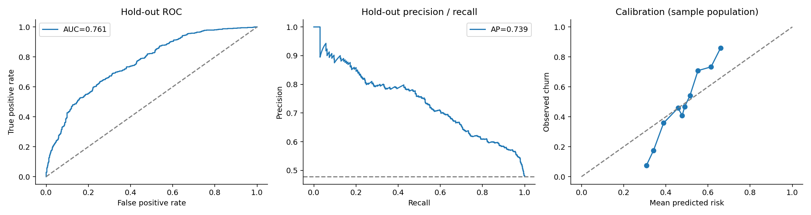
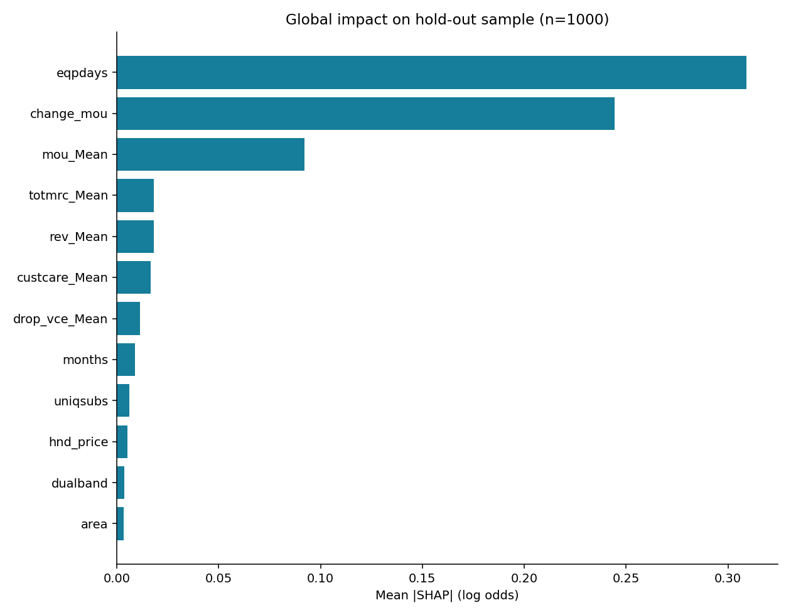

# Telecom Churn MLOps

An end-to-end customer churn portfolio project: reproducible experiments, signed model explanations, scheduled retraining, and a containerized prediction API.

**Python 3.12 · scikit-learn · CatBoost · SHAP · Apache Airflow 3.4 · FastAPI · Docker · GitHub Actions**

> The public demo uses independently generated **synthetic data**. It demonstrates engineering and evaluation methodology, not real-world predictive performance or measured retention impact. No third-party assessment document or private customer records are included.

## What you can run

- Generate a deterministic synthetic telecom dataset; train and compare logistic regression and CatBoost.
- Split customers into disjoint 60/20/20 train, validation and hold-out sets.
- Select the candidate by validation average precision, freeze a validation-F1 threshold, then evaluate the hold-out.
- Export global and individual SHAP explanations, calibration plots, ranking lift and versioned artifacts.
- Schedule the three-stage lifecycle with an Airflow 3 TaskFlow DAG.
- Serve a deliberately selected artifact through a Dockerized FastAPI API with schema checks and per-customer explanations.

## Quick start — five minutes, no private data required

Linux, macOS with Python 3.12, or Windows **WSL2 Ubuntu**:

```bash
git clone https://github.com/yipeng-913/telecom-churn-mlops.git
cd telecom-churn-mlops
python3.12 -m venv .venv
source .venv/bin/activate
python -m pip install -e '.[dev]'
make test
make demo
make serve
```

The repository URL above is the intended publication target. If you received the ZIP before publication, extract it and start at the `cd` step using its extracted directory.

Open [API documentation](http://localhost:8000/docs) and [health](http://localhost:8000/health). `make demo` writes local data and artifacts, then explicitly selects the evaluated artifact into `runtime/model.pkl`. It refuses to overwrite an existing raw dataset. To rerun generation, use a fresh directory/root rather than deleting private data.

```bash
# Inspect the selected model contract
curl http://localhost:8000/model

# Submit one complete synthetic customer; ask for signed SHAP explanations
curl -X POST http://localhost:8000/predict \
  -H 'Content-Type: application/json' \
  --data-binary @docs/example-request.json
```

The API requires every model feature, accepts explicit nulls, rejects unexpected columns and nonfinite numeric values, and limits each request to 100 customers. Explanations return five leading signed log-odds contributions, a baseline and the summed contribution of other features. This allows the returned components to reconstruct the raw model score. SHAP API explanations require the selected candidate to be CatBoost; logistic candidates still support predictions.

## Docker deployment

Generate and select the model with `make demo`, then:

```bash
docker compose up --build -d
curl http://localhost:8000/health
docker compose logs --tail=50 api
# Stop this project's API only:
docker compose down
```

The image runs as a non-root user, mounts the selected model read-only and exposes the API on the local machine at `127.0.0.1:8000`. Model/data files never enter the build context. A missing model causes startup to fail rather than serving a placeholder prediction. For a hosted deployment, mount your evaluated artifact into `/app/runtime/model.pkl` and place authentication, TLS and request limits at your platform's ingress. GitHub hosts the source and CI; it does not itself run this Python service.

## Architecture



Airflow coordinates `prepare_data → train_model → evaluate_model`. XCom carries paths; shared mounts hold run-isolated artifacts. Retries are deterministic for a fixed input. Training does not automatically promote a model into the API. See [deployment](docs/DEPLOYMENT.md), [model card](docs/MODEL_CARD.md) and [engineering decisions](docs/DECISIONS.md).

## Demo results and interpretation

See [the reproducible benchmark](docs/RESULTS.md) for the measured public-demo results and exact seed. These metrics describe the synthetic generator only. They must not be presented as results on a real telecom customer portfolio.





SHAP importance is model attribution, not causal evidence. Positive individual contributions raise log odds; they are not probability percentage points. Ranking high-risk customers does not show that an intervention will retain them. A campaign needs randomized treatment/control data and net retained margin to establish value.

## Project structure

```text
src/telecom_churn/   # data, training, evaluation, synthetic generator, API
scripts/            # explicit evaluated-artifact selection
dags/               # Airflow 3 TaskFlow DAG
tests/             # data-contract, split, scoring and API tests
docs/              # results, model card, deployment, CV and interview notes
.github/workflows/  # lint/test/synthetic integration + container build
compose.yaml        # standalone local API deployment
Dockerfile.airflow  # package installation in the existing Airflow cluster
```

Local raw datasets, pickles, customer-level exports, reports and `.env` files are ignored by Git. Public charts and metrics in `docs/` are generated only from the synthetic run.

## Test and automation

```bash
make lint
make test
python -m build
```

GitHub Actions installs the package on Python 3.12, runs lint and tests, trains on synthetic integration data, then builds the deployment image. CI success can be claimed only after the workflow runs on the published repository. See [validation evidence](docs/VALIDATION.md) for checks actually executed before publication.

## Portfolio and limitations

This is an individual portfolio implementation, not a claim of production ownership or realized business uplift. The current evaluation is a stratified random hold-out. Future-cohort validation, label maturity, source freshness, representative prevalence, intervention economics, drift monitoring and a governed promotion policy are required for operational use. MLflow, a business feature database and cloud infrastructure are extension points, not implemented components.

[中文说明及简历表述](docs/PORTFOLIO_中文.md) · [English CV and interview notes](docs/PORTFOLIO.md) · [MIT license](LICENSE)
