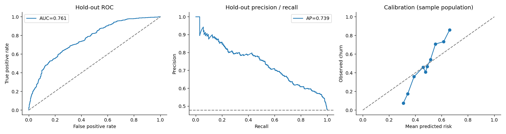
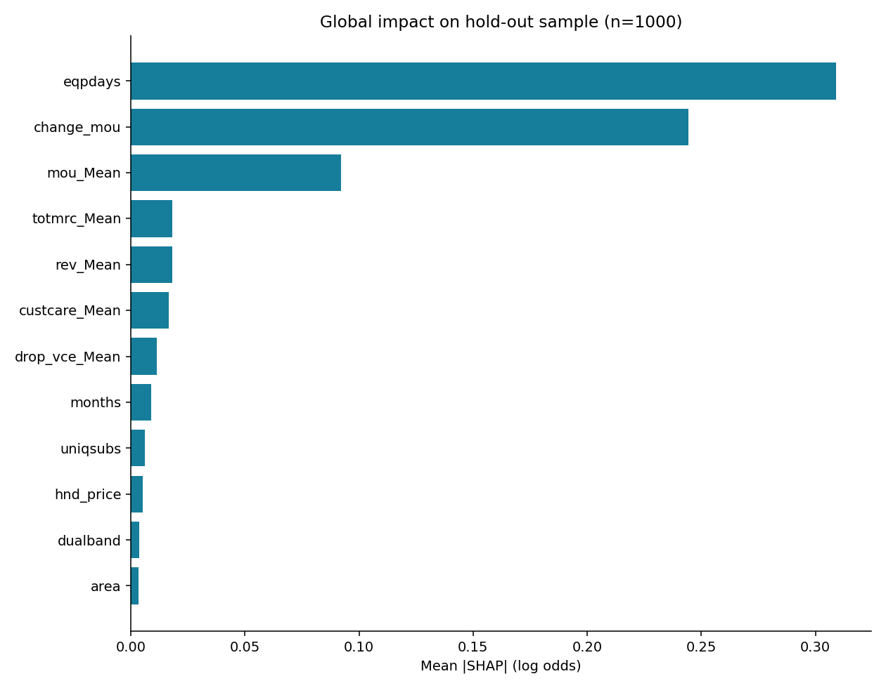
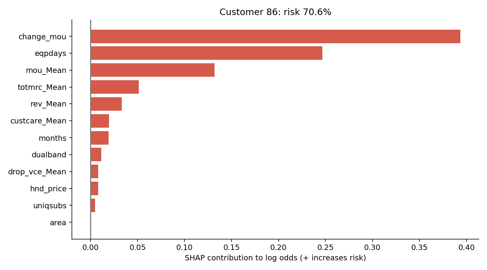

# Public synthetic benchmark

This benchmark uses **only independently generated synthetic data**. It is not a result on private customer records and does not estimate real-world retention effectiveness.

## Reproduce

```bash
churn-demo --root . --rows 6000 --seed 2026
churn-pipeline run --root . --run-id portfolio-demo
python scripts/select_model.py --run-id portfolio-demo
```

Run in a fresh checkout or separate root so the generator does not overwrite existing data. Seed 2026 generates 6,000 customers with 12 predictors and a known nonlinear churn mechanism; split seed 42 allocates 3,600 training, 1,200 validation and 1,200 hold-out customers. Package versions are pinned in pyproject.toml. No search was performed to optimize the hold-out results.

## Candidate selection — validation only

| Candidate | Validation AP | Validation ROC-AUC |
|---|---:|---:|
| Logistic regression | 0.6499 | 0.6930 |
| CatBoost | 0.7055 | 0.7301 |

Selected: **catboost**. CatBoost best iteration 12 (zero-based). Early stopping uses validation AUC, candidate selection uses validation AP, and the threshold 0.3654 is chosen by validation F1.

## Final hold-out — 1,200 synthetic customers

| Metric | Result |
|---|---:|
| Churn prevalence / random AP baseline | 0.4783 |
| Average precision | 0.7389 |
| ROC-AUC | 0.7606 |
| Log loss | 0.6158 |
| Brier score | 0.2125 |
| F1 at frozen threshold | 0.7072 |
| Precision | 0.5698 |
| Recall | 0.9321 |
| Top-20% precision | 0.7958 |
| Top-20% lift | 1.66× |
| Top-20% churn capture | 0.3328 |

Confusion matrix, actual rows 0/1 and predicted columns 0/1: `[[222, 404], [39, 535]]`. A fixed-model 200-replicate percentile bootstrap gives AP 0.704–0.775 and AUC 0.734–0.787. These intervals exclude training/selection uncertainty.



## Model explanation





SHAP attributes synthetic model log odds. It is not a causal estimate or evidence that a proposed contact or discount works. Global plots cover a fixed sample of up to 1,000 hold-out rows. The private assessment report, data, models and customer-level outputs are not included in this repository.

Aggregate machine-readable results: [benchmark.synthetic.json](benchmark.synthetic.json).
